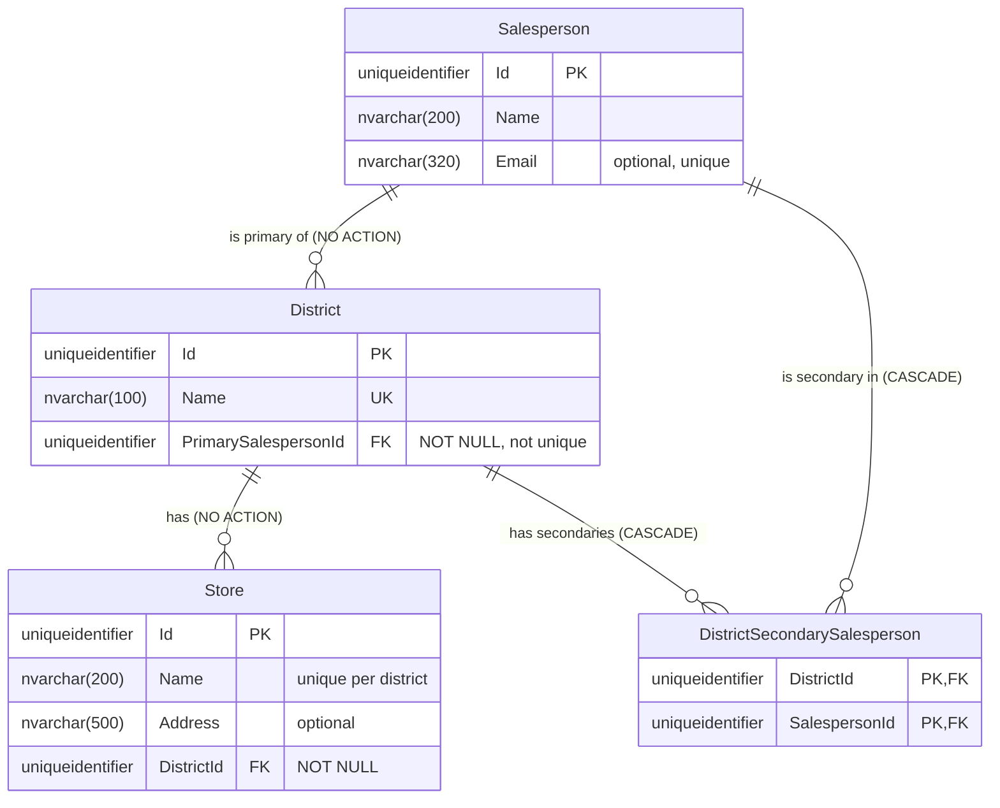

# SalesDistricts

Solution for the NEAS technical test. Salespersons sell to stores, stores sit in districts, every district has
exactly one primary salesperson and any number of secondary ones.

## Running it

```bash
cp .env.example .env                       # set a real MSSQL_SA_PASSWORD
docker compose up -d --build               # SQL Server + API; the API migrates the database on start
dotnet run --project SalesDistricts.Desktop
dotnet test                                # needs Docker only (Testcontainers)
```

The API listens on `http://localhost:8080`. The desktop app uses that by default; set `SALESDISTRICTS_API` to point
it elsewhere. Secrets live in `.env`, which is git-ignored; `.env.example` shows the shape.

Useful URLs: `/districts`, `/districts/{id}`, `/salespersons`, `/migrations` (applied and pending), `/openapi/v1.json`.

## Projects

| Project | Role |
|---|---|
| `SalesDistricts.Core` | Business rules and interfaces. No dependencies. |
| `SalesDistricts.Data` | SQL scripts, the migrator, and Dapper repositories over hand-written SQL. |
| `SalesDistricts.Api` | ASP.NET Core minimal API. Runs migrations at start-up. |
| `SalesDistricts.Desktop` | Avalonia desktop client (WPF-style). Talks only to the API. |
| `SalesDistricts.Tests` | xUnit: Core unit tests, database tests, end-to-end API tests. |

## Task 1: database

Schema `sales`, defined in `SalesDistricts.Data/Scripts/Ups/0001_InitialSchema.sql`.

| Table | Purpose |
|---|---|
| `Salesperson` | Id, Name, optional unique Email |
| `District` | Id, unique Name, **`PrimarySalespersonId` NOT NULL** |
| `Store` | Id, Name, optional Address, `DistrictId` NOT NULL, name unique per district |
| `DistrictSecondarySalesperson` | (`DistrictId`, `SalespersonId`) composite key; secondaries only |
| `vDistrictSalesperson` (view) | One row per (district, salesperson) with an `IsPrimary` flag |



Business rules and where each is enforced:

| Rule | Enforced by |
|---|---|
| A district **always** has exactly **one** primary | `PrimarySalespersonId` NOT NULL (at least one), single column (at most one) |
| Zero or more secondaries | Junction table; composite PK stops duplicates |
| The same person may be primary for several districts | Deliberately no unique index on `PrimarySalespersonId` |
| A primary cannot vanish from under a district | FK `ON DELETE NO ACTION`: reassign first |
| A store belongs to one district; districts with stores cannot be deleted | NOT NULL FK, `ON DELETE NO ACTION` |
| Names not blank, district names unique | CHECK and UNIQUE constraints |
| Deleting a district or a secondary-only salesperson cleans up assignments | `ON DELETE CASCADE` on the junction table |
| A salesperson belongs to one or more districts | Not enforceable in SQL Server (no deferred constraints). Not enforced on removal either, see Task 3 |
| The primary is not also a secondary of the same district | Data layer, inside the set-primary transaction |

The primary is a column on `District` rather than a flag on the junction table because that makes "exactly one"
structural. A flag would need a filtered unique index for "at most one" and a trigger for "at least one".

Keys are `uniqueidentifier` with `DEFAULT NEWSEQUENTIALID()`. Random GUIDs fragment a clustered index, and .NET's
`Guid.CreateVersion7()` does not help because SQL Server sorts GUIDs by their last bytes, so the server generates them.

### Migrations

A small hand-written migrator in `SalesDistricts.Data/Migrations`, styled after EF Core's: versioned scripts with
Up and Down, a journal table, and applied/pending status.

- A migration is a pair of files, `Scripts/Ups/NNNN_Name.sql` and `Scripts/Downs/NNNN_Name.sql`. No code change is
  needed to add one; the migrator discovers them as embedded resources. A line containing only `GO` separates batches.
- `0000_SchemaVersion` creates the journal table `dbo.SchemaVersion`. It is idempotent and runs on every connection.
- Each migration runs in one transaction together with its journal row, so a failure leaves nothing half-applied.
- `MigrationHostedService` applies pending migrations while the API starts, before it accepts requests.
  `GET /migrations` shows what is applied and what is pending. `DownAsync(target)` reverts to a version.

## Task 2: test data and client

`0002_SeedData` inserts five districts, six salespersons and ten stores with fixed ids, so its Down script removes
exactly those rows. It covers the interesting cases: a district with two secondaries, one with none, and Sofie
Pedersen as primary for two districts. Seeding through a migration is the simplest route for the test; in production
it would be a separate dev-only script.

The desktop app lists districts on the left and shows the selected district's salespersons (primary first) and stores
on the right, via `GET /districts` and `GET /districts/{id}`.

## Task 3: assigning salespersons

The rules live in `SalesDistricts.Core.DistrictAssignments` so the API can explain a refusal instead of surfacing a
constraint error:

- Making someone primary replaces the current primary in one transaction. The previous primary stays on the district
  as a secondary; the new primary is removed from the secondaries.
- The primary cannot be demoted or removed directly. The API answers 409 "assign another primary first".
- Adding someone who is already on the district is a no-op.
- Removing a salesperson's last district is allowed. Refusing it would make offboarding impossible.
- Reads and writes are not locked against each other. If two requests race, the database constraints still hold and
  one request fails with a constraint error.

Endpoints:

| Method | Path | Result |
|---|---|---|
| `GET` | `/salespersons` | All salespersons |
| `PUT` | `/districts/{id}/salespersons/{salespersonId}` with `{"role":"Primary"}` or `"Secondary"` | 204, 404, or 409 with a message |
| `DELETE` | `/districts/{id}/salespersons/{salespersonId}` | 204, 404, or 409 with a message |

Stine Rasmussen confirmed that individual delete operations are acceptable for this design, so removal is a `DELETE`.

## Tests

`dotnet test` needs only Docker. The database tests start a fresh SQL Server container per run and apply the real
migrations, which is the "test system without dependencies" from the commandments.

| Suite | What it proves |
|---|---|
| `Core/` (9) | Assignment rules, with an in-memory fake, no database |
| `Database/SchemaConstraintTests` (19) | Every Task 1 rule, by asserting on the SQL Server error number for each bad case |
| `Database/MigratorTests` (7) | Up, Down, status, ordering, rollback of a failing migration |
| `Database/DistrictRepositoryTests` (4) | Read queries against the seed data |
| `Api/` (7) | End-to-end through the real API with `WebApplicationFactory` |

## Architecture commandments

Answers from Stine Rasmussen (email, September 2026): the NEAS Market Model is not relevant for the test; authentication
is not required; Dapper over hand-written SQL is acceptable; DELETE versus PUT depends on the API design.

| Commandment | Here |
|---|---|
| SQL Server, ASP.NET Core Web API, Dapper, JSON, REST | Used |
| Desktop: C#, WPF | Avalonia, the cross-platform equivalent, so it runs on Linux and macOS too |
| Single system data ownership; don't use other systems' databases | Only the API touches the database; the desktop app uses the web service |
| All database code in git | Every table, view and seed script is a versioned file in `Scripts/` |
| Automated end-to-end tests | `Api/` tests through the real app |
| UTC for date/time values | `SchemaVersion.AppliedAtUtc` uses `SYSUTCDATETIME()` |
| Backwards compatible | Not yet versioned; the first breaking change would introduce `/v2` |
| Windows/AD authentication, Data Portal, `api.neasenergy.com` | Out of scope per Stine; would be added as authentication middleware and a reverse-proxy route |
| Serilog + ElasticSearch, ElastAlert, Jenkins + Octopus, RabbitMQ | Not implemented; described here as the production path. Logging is the built-in provider |
| Failover, CI, release procedure | Not implemented; `dotnet test` and `docker compose build` are the CI steps |

## What "production ready" would add

Serilog with structured logging to ElasticSearch, authentication, API versioning, a CI pipeline running the tests
against the Testcontainers database, a Dockerised desktop-free deployment, health checks, and optimistic concurrency
on district updates.
